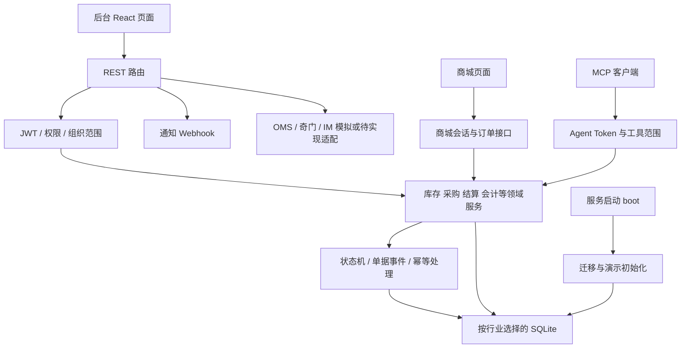

# GML / 伴圆 ERP 商用可行性源码审阅报告

审阅日期：2026-10-21（UTC）  
仓库：`https://github.com/osborn-studio/gml`，私有仓库  
固定版本：`a80b007494b20e8dc801d063f285e87145cbe15e`，默认分支 `main`  
性质：经授权的克隆与静态只读审阅；不是运行验收、渗透测试、法律意见或会计鉴证。

## 1. 决策结论

**当前版本不适合直接承接真实公网收费业务。项目具有进一步商业开发价值；在权属确认、生产环境与演示逻辑隔离、身份和数据权限缺陷整改，并完成实际验收之后，可以考虑单客户、单实例、范围受控的试点。**

这里必须分别回答两个问题：

| 问题 | 当前结论 | 主要依据 |
|---|---|---|
| A：许可和商业权利是否允许？ | **待确认，不能直接认定可商用** | 当前树没有项目 LICENSE/NOTICE；README 明确不自动授予开源或再分发许可；复用材料缺少锁定的上游版本和完整权属链 |
| B：技术上能否支撑真实收费？ | **不可当前直接上线** | 固定商城验证码、未认证库存接口、启动演示重建路径、部分数据越权、模拟连接器、尚未实测的运维和容量 |
| 是否只是界面原型？ | **不是** | 存在采购、收货、库存、结算、应收、退款、凭证等真实数据库和事务实现 |
| 是否已经是成熟的通用 ERP / AI ERP？ | **不能这样认定** | 外部支付、IM、OMS/WMS 等未闭环；AI 控制台主要为结构化意图查询和 MCP 工具层；未取得当前版本生产验证证据 |
| 最短商业路径 | **确认权属后，以限定业务流程的私有部署试点为起点** | 避开公共商城支付、多客户共享数据库和自动 AI 写账，把部署、培训、流程适配作为早期交付内容 |

不要把“许可证待确认”理解成已经判定侵权：如果用户确为全部原创部分的合法权利人，或拥有有效的委托开发、职务作品和授权合同，可以自行制定商业许可。反过来，能够访问私有仓库、仓库位于自己的组织、`private:true` 或未显示 fork，都不能证明全部代码及资源的权属。

## 2. 本次取得了什么，审阅到哪里

### 2.1 固定审阅对象和克隆状态

Mac mini 现有 GitHub 认证能够访问该仓库。父级连接器的 404 没有被当成仓库不存在或用户无权访问的证明；本次没有提取凭据、调整授权或绕过拒绝。

取得默认分支 `main` 的上述固定提交；Git 提交图共 109 个提交。远端元数据当时显示：创建时间 `2026-10-14T05:24:15Z`，推送时间 `2026-10-21T09:16:04Z`，`fork:false`、`license:null`。这些是远端元数据，不能替代版权调查。固定提交作者时间为 `2026-10-21T17:14:19+08:00`。

网络与工具连接一度中断。最终采取 Git 的 `blob:none` 部分克隆，并以经过 Git blob SHA 校验的同一提交文件补齐工作树。**它保留提交历史图，但并不代表所有历史版本文件内容都已离线下载；不是完整离线历史镜像。** 最终保留目录为 `/Users/osborn/Documents/Codex/2026-10-21/task-3/gml-filtered`；完成核验时间 `2026-10-21T15:41:30Z`，777 个 HEAD 文件均经 blob 哈希校验，工作区 clean，非 shallow，仍缺 1,448 个历史文件对象。详情见 `evidence/clone-provenance.json`。未覆盖已有用户 checkout。

### 2.2 可复核的规模

| 项目 | 静态统计 |
|---|---:|
| 当前提交跟踪文件 | 777 |
| 当前树文件总字节数 | 74,195,276 |
| server | 169 个文件，80,334 行 |
| src | 105 个文件，39,460 行 |
| scripts | 122 个文件，44,945 行 |
| reusable | 9 个文件，1,559 行 |
| REST 路由文件 | 39 |
| 领域服务文件 | 46 |
| 编号迁移文件 | 48 |
| `scripts/test-*.mjs` | 61 |

行数包含注释、空行和生成的类型等，**不是有效代码量或质量评分**。仓库包含大量文档、历史验收材料、截图及旧交付包，不能把它们全部当作当前源码。

### 2.3 方法与边界

本次完成目录与许可文件清点、锁文件清单解析、关键认证/权限/启动/数据库/商城/通知/MCP/部署路径逐段阅读，以及其余源码的静态关键词和调用路径筛查。重点追踪“入口 → 中间件 → 领域逻辑 → SQL/外部调用 → 返回/审计”。没有逐行穷尽全部 16 万余行代码，没有独立证明每个业务规则都正确。

**没有安装依赖，没有运行项目代码、测试、构建、服务、数据库迁移或仓库脚本，没有调用付费模型，没有利用漏洞或发业务请求，没有修改源码、提交或部署。** 自行编写的下载、哈希校验、清单和报告生成程序只处理静态文件。私有代码没有上传第三方扫描站。

没有当前运行环境、真实数据库、用户角色配置、支付/短信/模型合同、生产日志、并发指标和权属合同。历史测试报告只作为项目自述，不视为本次测试通过。二进制交付包没有执行，其中的旧版本也没有接受与 HEAD 同深度的源码审阅；图片和 DOCX 的作者、授权不能单凭二进制文件确认。历史文件对象没有全量离线取得，不能声称已完成全部 Git 历史秘密或复制来源扫描。

## 3. 产品、架构和实际可复用价值

### 3.1 产品是什么

这是一个以化妆品、食品供应链场景为主的“伴圆 ERP / GML 供应链协同系统”演示与方案验证工程，涉及总部、门店、经销商、商城和供应商协同。服装行业仍有开发/隐藏边界。README 对演示定位和真实服务接入的限制比“AI 原生 ERP”这一产品称谓更准确。[E01](证据索引.md#e01)

主要技术为 React 18 + TypeScript + Vite 6 + Tailwind 前端，Express 4 后端，同步 `better-sqlite3` 数据库，JWT 后台身份，独立商城会话，独立 MCP Agent Token。每个行业映射独立 SQLite 文件；这是一种行业演示隔离，不能直接等价为收费客户的租户隔离。[E02](证据索引.md#e02)、[E03](证据索引.md#e03)、[E06](证据索引.md#e06)

### 3.2 数据流

图表示主要源码关系，不代表所有入口都正确经过同一授权闸门；本报告发现的风险恰好包括若干旁路。

### 3.3 已有实际实现

| 功能链 | 源码证据与价值 | 仍需验证的边界 |
|---|---|---|
| 采购到收货 | `receivePurchaseOrder` 校验状态、数量和超收，将收货单、库存入库、供应商最近价格、已收数量及单据状态放在事务路径内。[E20](证据索引.md#e20) | 重复请求、同 SKU 多行、并发收货、价格/税费、异常回滚和质量处置仍需运行验收 |
| 采购发票、结算、付款、退货 | `purchase.js` 有独立建单、分摊、核销和状态流转函数，多处 `db.transaction`；并非仅修改页面状态。[E21](证据索引.md#e21) | 真实银行流水匹配、出纳复核、退款到款和财税制度不能由函数存在推定完成 |
| 库存与销售 | `stock.js`、`sales-order.js`、`returns.js`、`costing.js`、`transfer.js` 提供集中领域层，具有复用价值 | 批次、货权、成本、锁库与退款联动须按客户真实业务测试 |
| 会员促销 | 结算统一入口，券/积分/行级优惠留痕与订单事务结合。[E10](证据索引.md#e10) | 目前不能用下单动作替代支付到账确认 |
| 单据状态和审计 | 存在状态机、业务单据事件和 MCP 幂等/确认缓存事务；是正确的工程方向。[E13](证据索引.md#e13)、[E22](证据索引.md#e22) | HTTP/MCP 操作日志存在失败后继续的问题，不能宣称不可抵赖审计 |
| 财务和报表 | 有凭证、期间、关账及年度功能；不仅是报表截图 | 非 1 月开始的会计年度存在显式不支持分支；会计准确性和地域适用性未经会计人员验证。[E23](证据索引.md#e23) |
| AI / MCP | 工具注册、参数、授权范围、确认、幂等及审计框架有实现 | AI 控制台按意图和参数查询；真实大模型规划、可靠自主执行和客户端协议兼容性仍待接入/联调。[E24](证据索引.md#e24) |

### 3.4 宣称与实现必须分开的部分

1. **IM 同步**：`getImTransport` 在配置满足后仍抛 `IM_REAL_CALL_NOT_IMPLEMENTED`；模拟注入和适配器结构不等于飞书/钉钉/企微真实同步。[E25](证据索引.md#e25)
2. **OMS 同步**：现有同步路由会生成随机订单，不能视为真实电商平台拉单。[E26](证据索引.md#e26)
3. **奇门/WMS**：查询会读真实库，但若干写类方法返回模拟成功；这同时是安全问题和业务误导风险。[E07](证据索引.md#e07)
4. **支付**：商城下单即写 `pay_time` 并进入结算处理，尚无真实支付网关验签、到账、退款和对账闭环。[E10](证据索引.md#e10)
5. **AI**：`AiConsole.tsx` 的意图选择和 `/ai/query` 的受限 SQL 分支有用，但不是已经交付的大模型 Agent。[E24](证据索引.md#e24)
6. **财务边界**：非自然会计年度和部分库存交易类型到凭证的映射仍有明确限制，客户需求超出这些边界时必须单独开发。[E23](证据索引.md#e23)

适合继续投入的资产包括：领域建模、状态流转内核、库存与结算规则、操作界面、客户沟通原型及测试样本。最适合的早期场景是内部方案演示、流程访谈、受控的采购库存试点。对公众开放商城、作为多租户 SaaS、替代成熟财务总账或宣称自动 AI 操作无需人审，当前证据均不足。

## 4. 许可、上游和资源权属

### 4.1 项目本体

当前 Git 树根目录和子目录没有按 `LICENSE / LICENCE / NOTICE / COPYING / COPYRIGHT` 命名的文件。`package.json` 的 `private:true` 表示 npm 发布保护，不是商业许可。README 第 143 行明确说明交付不自动授予开源或再分发许可。[E01](证据索引.md#e01)、[E02](证据索引.md#e02)

没有许可证通常意味着未公开授予所需版权权限，不能理解为可以自由商用；GitHub 的相关说明也明确区分代码可见性与复制、修改、分发权。[S01] 本次没有取得委托开发合同、员工/外包知识产权归属、贡献者授权或单独商业许可证。

需确认的不是“必须把自己的私有软件开源”，而是：谁能授权、授权覆盖哪些原始及衍生成果、用户能以什么模式提供服务/交付、第三方要求是否被保留。

### 4.2 直接复用与来源证据

`reusable/README.md` 声明促销参考 Medusa、账本参考 Medici、RBAC 参考 node-casbin。促销和账本源码头还列出上游文件或设计位置，说明来源不是完全未知；但未锁定原始 tag/commit、复制范围和修改记录，也没有随模块附上完整上游许可与版权文本。[E14](证据索引.md#e14)

| 来源 | 当前公开主来源核查 | 本仓库仍缺什么 |
|---|---|---|
| Medusa promotion | 当前 `develop/LICENSE` 对适用范围提供 MIT；另有 Enterprise License，部分企业功能要求独立商业协议。[S04、S05] | 实际参考版本、文件范围、原始版权和许可副本；不能拿今天 develop 的许可追认过去所有拷贝 |
| Medici ledger | 当前官方仓库 LICENSE 为 MIT。[S06] | 实际复用版本、改写与复制边界、应保留的版权通知 |
| node-casbin / Casbin Node | 官方仓库许可证为 Apache-2.0。[S07] | 声称“仅设计参考”是否成立；若含实际代码，须逐文件落实许可、修改和 NOTICE 要求 |
| 其他曾评估项目 | 内部文档提及排除 AGPL/GPL/EPL 或无许可证项目 | 文档中的“已移除/不使用”不是历史与现存代码均无复制的证明；本次未作全量相似性与历史比对 |

内部策略文档有“保留版权”的表述，也有“清理他人项目/公司名称”的表述。[E15](证据索引.md#e15) 去除产品品牌与移除法律要求保留的版权/许可声明是不同动作。应澄清规则，不宜据此直接认定已经侵权，也不宜把改名当作授权完成。

MIT 允许商业使用、修改和销售等，但要求在软件副本或重要部分保留版权和许可声明；无担保条款不意味着交付商对客户可以免除合同责任。[S02] Apache-2.0 同样可用于商业产品，分发时须遵守许可证副本、修改说明及适用通知要求；其商标条款不授予一般商标使用权。[S03]

当前 Medusa 的企业许可不应笼统套到本仓库全部促销代码，也不能笼统忽略：应以**实际取得版本和实际复用文件**判定。[S04、S05] 以上为工程尽调结论，最终权利安排需结合合同和适用法律确认。

### 4.3 锁文件依赖清单

`package-lock.json` 解析出 376 个非根包条目，其中 129 个未标为 dev、247 个标为 dev。这里是安装树条目数，不能直接当作 376 个不同供应商。完整版本、来源 URL、声明许可证、安装脚本标记见 `evidence/dependency-lock-inventory.csv`。[E02](证据索引.md#e02)

| 声明许可证 | 条目数 |
|---|---:|
| MIT | 323 |
| ISC | 34 |
| Apache-2.0 | 8 |
| BSD-3-Clause | 6 |
| CC-BY-4.0 | 1 |
| MIT OR WTFPL | 1 |
| BSD-2-Clause OR MIT OR Apache-2.0 | 1 |
| 0BSD | 1 |
| MIT AND ISC | 1 |

主要锁定版本：Express 4.22.3、better-sqlite3 11.10.0、bcryptjs 2.4.3、jsonwebtoken 9.0.3、cors 2.8.6、dayjs 1.11.23、nanoid 5.1.16、zod 3.25.76、React/React DOM 18.3.1、React Router 7.18.4、Vite 6.4.5、TypeScript 5.9.3、Tailwind 3.4.19、Recharts 2.15.4、lucide-react 0.460.0、fflate 0.8.3。

特别标记：`caniuse-lite 1.0.30001816` 声明 CC-BY-4.0；`victory-vendor 36.9.2` 声明 MIT AND ISC；多选许可证表达式需要明确选择与保留依据。`better-sqlite3`、`esbuild 0.25.12`、`fsevents 2.3.3` 声明安装脚本，本次未执行。376 个条目都有 integrity 字段；340 个 resolved URL 指向 registry.npmmirror.com，36 个指向 registry.npmjs.org。镜像来源不是恶意证据，但应在发行治理中确认可信源、完整性和可重建性，不能把全部安装来源写成 npm 官方源。

**这只是锁文件声明清单，不是已核验的完整法律 SBOM。** 没有安装包内容逐项审查、原生二进制许可证核验、前端 bundle 归属映射、镜像 OS 依赖清单或交付物 NOTICE 检查；不能据此宣称“所有依赖允许无条件闭源销售”。打包脚本复制指定目录，未见完整第三方通知生成步骤。[E16](证据索引.md#e16)

### 4.4 资源、模型与数据

当前树包含 PNG 截图、图标/ICNS、网页手册、DOCX 和旧 ZIP。两个旧 ZIP 的中央目录分别有 209 和 16 个条目，均未列出 LICENSE/NOTICE 等命名文件；此结果不涵盖嵌套压缩内容及 bundle 中的内嵌通知，也不证明历史包的全部许可状况。未在文件清单发现明确的模型权重、嵌入式字体文件或独立训练数据包。CSS 的系统字体名称/回退字体不等于分发该字体；以后嵌入商用字体需重新确认。截图、品牌图标、产品名称及示例业务数据是否全部原创/获授权，不能从文件存在推定。应建资源清单，列来源、权利人、允许用途、是否可再分发及证据。

当前 AI 层没有提供可据以确认商用的模型合同。未来接入任何模型、短信、支付、地图、企业通讯或电商平台，都要分别核对服务条款、数据用途和费用，不能把本仓库的许可结论延伸到尚未接入的服务。

### 4.5 按商业模式判断

| 商业模式 | 权利前提 | 技术判断 |
|---|---|---|
| 权利人内部自用 | 确认原创/职务/委托成果和上游使用权；私用也不自动洗清第三方权属 | 演示可用；真实数据试点仍必须先解决启动造数、账号及权限问题 |
| SaaS 对外收费 | 取得运行服务所需权利；核查实际依赖义务和输出到浏览器的分发内容；不能简单说 SaaS 永远没有分发义务 | 当前不建议；需客户级租户边界、运营安全、资源配额、支付/支持/恢复体系 |
| 客户私有化交付 | 明确复制、修改、安装、客户使用与升级授权；交付依赖及资源通知、支持和数据责任 | 整改后最可行的试点模式；一客户一实例/数据库/密钥/备份 |
| 二次分发、改牌或闭源销售 | 需要明确再分发/衍生授权、上游通知、商标和贡献者权利 | 当前不得仅凭仓库访问权发行；不能删除版权声明来实现“自有品牌” |

项目本体不必为了商业销售改用开源许可；可以由适格权利人采用私有商业合同，但第三方义务不能被该合同抹去。

## 5. 主要发现

分级：P0 为上线/发行前必须阻断的事项；P1 为真实业务试点前或对应功能启用前整改；P2 为后续质量工作。严重度结合商业部署场景，和漏洞数据库 CVSS 不等价。“静态确定”表示控制流/代码行为确定，不表示本次已经运行复现；“风险/待验证”表示影响仍依赖部署或业务条件。

### F01 — P0：商业授权链没有闭合

- **性质/置信度：** 证据缺口，高。
- **位置/证据：** 当前树无 LICENSE/NOTICE，README:143；复用说明与源码头。[E01](证据索引.md#e01)、[E14](证据索引.md#e14)、[E15](证据索引.md#e15)
- **触发：** 将代码交付客户、改牌出售、开放收费服务，或将第三方改写模块视为完全原创。
- **影响：** 不能证明享有所需权利，发行通知可能遗漏，商业合同无法作出可靠权属保证。
- **建议/验收：** 权利人签署本体授权；补员工/外包/贡献者归属；为每个复用模块锁上游 SHA、许可、差异与通知；对交付包生成第三方声明。无法核实的模块移除或独立重写，并保留来源调查记录。

### F02 — P0：商城固定演示验证码可签发任意手机号会话

- **性质/置信度：** 静态确定，高。
- **位置/证据：** `server/routes/mall.js:114-138`，验证码为固定演示值，未见生产环境禁用条件。[E08](证据索引.md#e08)
- **触发：** 商城登录接口可达，调用方知道演示验证方式并选择手机号；不要求实际持有手机号。
- **影响：** 商城身份冒用，关联订单、地址和会员权益存在暴露/滥用风险；即使后台 JWT 强密钥也无法补救此登录路径。
- **建议/验收：** 生产拒绝演示认证；接入一次性验证码，绑定号码、用途、短时效和尝试次数，限制请求频率；验证验证码不能重放、跨号使用，错误尝试锁定。报告不输出固定验证码值。

### F03 — P0：奇门网关允许未认证读取库存，写操作又可能只返回模拟成功

- **性质/置信度：** 静态确定，高。
- **位置/证据：** `server/index.js:203` 挂载；`routes/qimen.js:158-178` 未要求登录，缺 app_key 放行，`32-35` 缺签名也放行；`204-228` 查询库存实际表；`231-283` 含模拟写响应。[E07](证据索引.md#e07)
- **触发：** `/api/qimen` 对外可达；访问者发起支持的查询方法。无需利用 SQL 注入即可触及业务数据。
- **影响：** SKU、数量、预留/可用库存泄漏；对接方可能把成功响应误当成真实出入库结果。
- **建议/验收：** 正式环境默认不挂载模拟网关；真实网关强制客户身份、完整签名、时间戳/重放保护及仓库/货主范围；不支持操作明确失败；未签名、越权仓库、跨客户和重复报文测试必须拒绝。

### F04 — P0：正常启动仍可进入破坏性演示重建和样本补数

- **性质/置信度：** 静态确定，高；具体生产触发概率取决于数据状态。
- **位置/证据：** `index.js:158-163` 每次调用 boot；`db/boot.js:108-123` 由 `!isSeeded()` 触发 seed；`db/index.js:192-203` 仅以 products 行数判断，计数异常返回 0；`db/seed.js:392-415,481-482` 重建表。[E04](证据索引.md#e04)
- **触发：** 已有业务库的 products 为空，或计数操作异常被吞掉；不是“每次正常重启都清库”。此外 `boot.js:140-205` 在无需整库种子时仍调用多个样本初始化，部分函数仅凭局部哨兵判断是否补数。
- **影响：** 真实业务表丢失或样本数据污染；恢复/迁移异常可能被误判为首次启动。财务样本会触及期初、结转和关账等流程。[E05](证据索引.md#e05)
- **建议/验收：** 生产 boot 只做明确版本迁移和必要配置，不执行任何演示 seed；显式一次性初始化标志，数据库异常 fail closed；演示数据命令要求独立空库。测试“业务库 products 为空”“部分迁移失败”“恢复后重启”等场景，确认数据不减少、不新增演示凭证/订单。

### F05 — P1（多角色公网场景阻断）：通知预览缺少业务权限和数据范围过滤

- **性质/置信度：** 静态确定，高。
- **位置/证据：** `routes/notify.js:133-145` 仅 requireAuth；`lib/notify.js:152-179` 调全局摘要；`lib/purchase.js:1931-1971` 与 `lib/approval.js:586-598` 查询全局待办。[E09](证据索引.md#e09)
- **触发：** 有效后台账号即使仅应看门店/经销商范围，也可调用预览接口；具体可见字段以摘要类型为准。
- **影响：** 同行业库内采购单号、金额、待审批/待付款等业务信息可能越权泄露。
- **建议/验收：** 与页面业务权限一致；全局摘要要求全局数据权限，或把组织/仓库/货主范围传入所有摘要查询；以最低权限角色交叉验证，不仅测试管理账号。

### F06 — P1：后台密码治理和会话撤销不足

- **性质/置信度：** 静态确定的设计缺口，高；攻击成功与暴露面有关。
- **位置/证据：** `routes/auth.js:25-42,165-210`；`middleware/auth.js:222-301`；`src/store/auth.tsx:76-80`。[E11](证据索引.md#e11)
- **触发：** 密码泄露后用户改密/管理员重置，旧 JWT 仍在有效期内；公网登录遭批量尝试。
- **影响：** 改密不能可靠结束已签发会话；最低密码长度偏低，登录错误区分用户存在性，未发现通用登录限速/锁定。`bcrypt.compareSync` 在大量尝试下还占用事件循环。
- **建议/验收：** session version / revoked-after 或服务端会话；改密、重置、风险事件统一失效；密码与登录限速策略；成功/失败审计。用户状态和角色会重新从 DB 获取，停用/降权对后台 JWT 是已有优点，不能误报为完全不校验账号。
- **附注：** 浏览器 localStorage 保存 token，增加 XSS 后持久凭据被取走的影响；它本身不是已证明的 XSS。应按前端安全模型选择 HttpOnly Cookie 或严格 CSP/短期 token。

### F07 — P1：MCP Token 没有统一继承所有者当前停用/权限状态

- **性质/置信度：** 静态确定的授权不一致，高；是否定义为独立服务账号还需产品政策确认。
- **位置/证据：** `mcp/tokens.js:124-138` 校验 token 状态/有效期；`mcp/server.js:159-171` 组上下文；`mcp/tools.js:333-356` 查所有者但不检查 status，`1089-1109` 调拨仅以 token 仓库范围执行；`routes/auth.js:179-193` 停用未联动撤销。[E12](证据索引.md#e12)
- **触发：** 已签发 write token 的所有者被停用或降低业务权限，而 token 仍 active。
- **影响：** HTTP 人工入口拒绝的人/动作，部分 MCP 工具仍可能继续；采购工具局部调用权限校验不能保证所有工具都等价。
- **建议/验收：** 明确人类委托 token 与独立服务主体；人类委托执行时校验所有者存在、启用、当前权限和数据范围，停用联动撤销。逐工具做“签发后停用/降权/转组织”的验收，尤其库存写工具。

### F08 — P1：通知 Webhook 可向任意目标发请求，响应资源限制不完整

- **性质/置信度：** 高置信度风险，需具备配置/推送权限，非匿名 SSRF。
- **位置/证据：** `routes/notify.js:87-105,151-160`；`lib/notify.js:87-141,279-320` 保存 URL 后直接 fetch，未见目标地址白名单及私网阻断。[E17](证据索引.md#e17)
- **触发：** 有管理/推送权限的用户或被攻陷账号配置恶意目标；默认重定向可能改变目标。请求计时器在接收 body 之前清除。
- **影响：** 服务端访问内网地址、业务摘要发往非批准目的地，慢/大响应占用资源；响应 body 阶段缺少完整超时和大小上限。
- **建议/验收：** 限制批准 HTTPS 域和端口、禁私网/回环/链路本地及 DNS 重绑定，逐跳校验或禁重定向；网络出口策略；总超时/响应大小限制。用受控测试目标验证，不接触真实内网敏感服务。

### F09 — P1：启动日志输出可用 Agent Token，通知秘密明文持久化

- **性质/置信度：** 静态确定，高。
- **位置/证据：** `db/boot.js:215-219` 打印 token；`mcp/tokens.js:172-188` 自动签演示 read/write/danger 凭据；`lib/notify.js:74-75,97-101` 保存/返回渠道秘密。[E18](证据索引.md#e18)
- **触发：** 新库/首次生成凭据，日志由维护者或集中平台收集；渠道管理员读取配置或数据库/备份泄露。
- **影响：** “仅显示一次”不等于未被日志永久保存；高权限 token 可经日志横向传播。数据库和备份需要按含秘密材料管理。
- **建议/验收：** 生产不自动生成演示 token；安全领取一次性凭据；日志统一脱敏；权限更细的秘密管理/加密和轮换。对曾进入日志的有效凭据做吊销与重签。报告只定位，不展示秘密值。

### F10 — P1：商城结算不等于真实资金闭环

- **性质/置信度：** 静态确定，高。
- **位置/证据：** `routes/mall.js:378-415` 在下单事务写 pay_time 并结算；OMS/IM/奇门模拟路径见前文。[E10](证据索引.md#e10)、[E25](证据索引.md#e25)、[E26](证据索引.md#e26)、[E07](证据索引.md#e07)
- **触发：** 把现有商城当成能真实收款、自动发货或退款的收费产品。
- **影响：** 订单和会员权益可能先于资金确认变化；缺失网关验签、回调幂等、金额币种核对、退款状态和独立对账证据。
- **建议/验收：** 未接入前禁用相关承诺或明确为人工登记；付款状态机分离待付/已付/退款中/已退款；账款以服务端校验结果为准。验证重复/乱序回调、金额不符、网络超时和退款失败。后台手工记录收付款可以是有效业务模式，但必须由真实凭证和人工复核支撑。

### F11 — P1：行业分库不是可售 SaaS 的客户租户隔离

- **性质/置信度：** 架构风险，高。
- **位置/证据：** `db/index.js:43-46` 行业映射；行业请求上下文与 token 边界在 `server/index.js`；领域业务主要落同一行业库。[E03](证据索引.md#e03)
- **触发：** 将两个独立收费客户放在同一个行业库，以组织/门店角色代替完整客户边界。
- **影响：** 全局配置、摘要、种子、备份和管理接口可能跨客户共享；不能保证租户级隔离、删除、恢复和资源计量。
- **建议/验收：** 早期每客户独立实例、数据库、密钥、存储和备份；以后建设统一 tenant 上下文和数据库约束，再做完整跨租户负向测试。没有必要仅因 SQLite 就重写系统；先决定客户边界和容量目标。

### F12 — P1：备份验证结果和升级恢复尚不能支撑承诺

- **性质/置信度：** 部分静态确定、部分未验证，高/中。
- **位置/证据：** `scripts/db-backup.mjs:95-133,165`；`scripts/local-manage.mjs:117-131`；`db/migrations/runner.js:54-96` 的逐迁移事务与版本登记见证据索引。[E19](证据索引.md#e19)、[E27](证据索引.md#e27)
- **触发：** 新备份校验失败或备份期间多库变化；升级后需要回滚；依赖脚本退出码作成功判断。
- **影响：** db-backup 在新备份校验前轮转旧副本，且完整性不通过未计入 failed 退出逻辑，可能错误报告成功；单库一致性不等于三库同一业务时刻。缺少实测 RPO/RTO、异地恢复和版本回退证据。
- **建议/验收：** 新副本校验并试恢复成功后再轮转；任何校验失败都非零退出；备份加密、异地、保留策略；发布前备份与兼容迁移，恢复演练记录数据笔数及关键余额。已有 SQLite backup/VACUUM INTO 和单迁移事务是优点，并非完全没有备份/迁移能力。

### F13 — P1：操作审计可失败后继续，URL 凭据和异常信息可能进日志/响应

- **性质/置信度：** 静态确定，高。
- **位置/证据：** `middleware/audit.js:82-119` 捕获日志失败；`mcp/server.js:144-156` 审计异常被忽略并保存部分 args；`middleware/auth.js:259` 和 MCP 凭据提取支持 query token；`lib/http.js:85-105` 返回错误细节，`middleware/audit.js:126-133` 记录 originalUrl。[E13](证据索引.md#e13)
- **触发：** 审计表/磁盘异常、敏感参数被放入 URL 或 MCP 参数、内部错误抛出数据库/配置细节。
- **影响：** 某些操作成功却缺少外围审计；访问/错误日志可能留凭据和个人信息；内部结构泄露。业务单据事件与操作日志不是同一层，不能笼统说所有记账都没有审计。
- **建议/验收：** 凭据仅从受控认证头取；统一脱敏/错误码；对高风险变更采用事务性审计/outbox 或明确失败策略；日志访问权限和保存期限；测试审计落盘失败和个人信息脱敏。

### F14 — P1：容器交付默认携带开发依赖，供应链仍有已知未修复公告

- **性质/置信度：** 配置与依赖存在静态确定；可利用性待验证。
- **位置/证据：** `Dockerfile:10,28` 构建安装后复制 node_modules，未见 USER/prune；compose 发布端口；锁文件 braces 3.0.3。[E28](证据索引.md#e28)、[E02](证据索引.md#e02)
- **触发：** 直接按当前容器路径对外部署，或不受信任模式字符串进入相关构建工具。
- **影响：** 运行镜像含不需要的开发依赖、权限面偏大；braces 官方公告列为高危栈耗尽，版本 <=3.0.3 且核查时无补丁。[S08] 开发依赖在镜像存在**不等于已经证明公网接口可利用**。
- **建议/验收：** 多阶段最小运行依赖、非 root、固定镜像摘要、构建隔离、限制外部输入；建立公告跟踪和替代路径。不要宣称“安全告警清零”。README 所称其余 11 条已修复未在本次逐一独立验证。
- **已有保护：** 生产强 JWT 秘密检查；本地管理器随机生成秘密、配置权限和回环监听优于直接公网启动。Docker 发布范围仍要单独核验。

### F15 — P1：测试资产较多，但没有当前可重复生产验收证据

- **性质/置信度：** 证据缺口，高。
- **位置/证据：** 61 个 test 脚本、`regress-all.mjs`、`regress-isolated.mjs`；当前树无 `.github/workflows`；`tsconfig.json` 的 strict:false 且主要覆盖 src。[E29](证据索引.md#e29)
- **触发：** 把历史文档的“通过”当作当前提交与交付包的 CI 结果。
- **影响：** 权限、财务、迁移和恢复回归风险没有持续闸门；不知道实际分支覆盖、漏洞负向测试或性能边界。
- **建议/验收：** 对固定版本在隔离副本执行现有测试，补本报告缺陷回归和客户真实验收样本，保留命令/环境/退出码/日志/数据库核对证据；发布门禁必须验证精确发行包。不能只把测试文件数换算覆盖率。

### F16 — P2：API 状态与版本契约存在不一致

- **性质/置信度：** 静态确定，高；前端用户影响需联调。
- **位置/证据：** `routes/mall.js:573-593` 取消走 cancelled 状态，但返回 closed；`index.js:174`、meta/AI manifest 与 package 的版本字符串不一致；`vite.config.ts` 注释包括 /mcp 而代理仅有 /api。[E30](证据索引.md#e30)
- **触发：** 客户端依赖取消返回状态、运维根据健康/manifest 版本判断发布，或开发中使用同源 MCP。
- **影响：** 客户端显示/缓存混乱、版本溯源不可靠、联调路径误判。
- **建议/验收：** 返回持久化后的真实状态；单一版本来源并嵌入构建 SHA；接口契约测试；明确 MCP 实际地址与协议。

## 6. 安全审阅的其他观察与未确认项

### 6.1 已看到的有效防护

后台认证区分用户凭据和商城/Agent 凭据，检查 JWT audience，并从数据库重新读取用户/角色；多个业务入口有权限及组织范围辅助函数；许多 SQL 使用绑定参数；采购收货和结算等写路径使用数据库事务；MCP 有 token 哈希、级别/范围、确认与幂等框架。不能因为发现旁路就把整个项目描述为完全没有安全设计。[E11](证据索引.md#e11)、[E12](证据索引.md#e12)、[E20](证据索引.md#e20)、[E22](证据索引.md#e22)

### 6.2 注入、文件访问、执行与上传下载

对 SQL 拼接、动态标识符、HTTP fetch、文件操作、子进程、模板插入、上传和导出相关位置进行了静态筛查。未在本次重点路径确认可直接利用的通用 SQL 注入、任意文件读写或远程执行链；**这不是已排除所有此类漏洞**。动态 SQL 的安全性需逐个确认标识符白名单，不能由多数参数绑定推及全部查询。

项目含运维/发行脚本和本地路径操作；它们是否在实际安装方式下可被非可信输入触达，本次没有运行验证。上传、压缩包、导出文件名、公式注入、富文本和浏览器 XSS 需在启用对应功能前按真实入口测试，不能仅凭 `rg` 命中或未命中判定通过。

### 6.3 隐私与数据治理

手机号、收货地址、会员、客户、供应商和财务信息会落入数据库，通知摘要、审计 args、错误日志及备份可能扩大接触面。当前没有取得实际保留期限、删除机制、授权告知、运营组织或跨境流向证明。建议按交付地区和客户身份建立数据清单、最小访问、导出审批、备份期限和事件响应。这里是产品合规需求待确认，不作地域法律结论。

### 6.4 资源限制、供应链和秘密扫描边界

未发现覆盖所有登录/商城/API 的统一频率限制；MCP 特定日志计数配额不能等同所有端点资源治理。同步数据库和 bcrypt 会占用单进程处理时间；大量报表、导出、通知或昂贵查询的隔离与超时仍需设计。

源码中的演示秘密和凭据输出位置已标记；没有把任何值复制进报告，也没有读取用户 GitHub 凭据。没有完成所有历史二进制/历史提交的秘密调查，不能出具“仓库无秘密”证明。

## 7. 持久化、运维、可维护性与容量

SQLite 开启 WAL、foreign_keys，配置 busy timeout；对小规模单实例业务可以合理，不应以数据库品牌直接判死刑。[E03](证据索引.md#e03) 真实容量取决于 SKU/批次/订单量、查询方式、并发写、磁盘、报表与备份负载。本次无压测、执行计划采样或真实业务曲线，不能承诺 QPS、日订单数或可用性百分比。

迁移已有逐项事务及登记表，降低单次失败破坏；但以文件名记录为主，缺少已部署迁移校验和、完整逆向迁移及当前版本恢复演练证据。生产应禁止随意修改已应用迁移，采用前向修复和兼容发布；不要仅回退应用代码却保留不兼容 schema。[E27](证据索引.md#e27)

备份已有 SQLite 一致性快照工具；本地管理器保护配置文件权限是正面设计。生产还需定义客户可接受的 RPO/RTO、离线/异地副本、加密、保留、恢复权限和演练。跨行业数据库若存在业务相关性，顺序单库备份需停写或建立共同一致性点；若互不相关，则分别恢复也要写入交付约定。[E19](证据索引.md#e19)

代码有一定领域分层和集中规则，但单文件规模大、前后端类型契约部分生成、后端 JavaScript 无统一静态类型保护，且多处演示数据与业务实现混合。优先拆出生产启动边界和统一授权策略，比立即重写全部框架更有收益。内部大量中文设计、问题修复记录和测试是交接资产；同时说明提交时间密集、演进快，需要对变更回归建立可信证据。

监控方面有 health、metrics、日志和业务审计等基础，尚未证明具备外部告警、SLO、错误聚合、备份失败通知、容量趋势和可操作的事故手册。现有接口返回健康不等于业务正确，也不等于恢复可用。

## 8. 整改顺序与最小可行商用路径

### 8.1 优先级清单

| 优先级 | 事项 | 完成证据 |
|---|---|---|
| P0 | 项目与复用资产授权链；发行通知 | 权利文件、来源 SHA、许可副本、第三方清单、交付授权范围 |
| P0 | 移除生产演示 OTP、未认证奇门与模拟成功响应 | 未认证/无签名/演示身份在生产模式全部拒绝的测试 |
| P0 | 启动与 seed 完全隔离 | 空产品表、异常库、升级/恢复重启均不造数/不清库的测试 |
| P1 | 通知摘要授权、MCP 撤权、会话失效 | 不同角色/组织/客户的负向测试矩阵 |
| P1 | 密钥与日志、SSRF、限速、错误脱敏 | 轮换记录、日志抽查、受控目标测试、频率限制证据 |
| P1 | 真实收付款或明确人工模式，禁未完成连接器 | 业务验收、对账、重复/乱序事件测试 |
| P1 | 备份/迁移/恢复/发行包验证 | 可恢复副本、RPO/RTO 实测、升级失败恢复演练 |
| P1 | 容器最小化、依赖风险和 CI 闸门 | 精确镜像/包 SHA、依赖清单、测试结果、公告处理记录 |
| P2 | 版本/API 一致、类型、模块拆分、可观测性 | 契约测试、统一版本、告警/运维手册 |

### 8.2 建议先交付的产品边界

第一阶段定位为“单客户私有部署的采购—库存—销售辅助系统试点”。选一个行业、一条闭环、少数可信操作员；新建正式空库，演示数据另放；客户独立实例和密钥；保留现有正式账本/银行系统作为资金和会计依据。默认关闭公共商城、奇门模拟、随机 OMS、未实现 IM、MCP 危险写操作；待某功能通过专项验收再启用。

先通过实施、配置、培训、数据导入和支持形成可交付价值。销售合同明确试点功能、限制、数据归属、备份责任、退出导出、支持时间和故障处理，不把待实现连接器或“大模型自动财务”写成现成功能。

第二阶段再选择一种真实连接器或支付渠道，按事件、签名、幂等、重试、对账和告警完整实现。第三阶段才评估多租户 SaaS、公共用户、账单系统及更高并发；这可能需要数据库和部署架构调整，应由负载和边界证据驱动。

### 8.3 试点最低验收标准

1. 权属与发行材料完整，客户使用模式有明确授权；当前锁定版本及交付物哈希可追溯。
2. 生产启动不写演示业务数据；不存在固定认证绕过、未签名网关和默认高权限演示 token。
3. 每个启用角色/组织/接口有正向和越权测试；账号停用、改密、降权对人类和委托 Agent 立即按设计生效。
4. 用客户认可的样本走完整采购、收货、库存、销售、退货/退款及必要凭证链；单据、库存、成本、应收应付能够逐项核对。
5. 重复提交、并发抢库存、失败中断、重启、迁移失败、备份损坏、恢复后重复事件都不产生重复记账或静默丢数据。
6. 明确实际负载目标，例如约定用户并发、订单/明细规模、报表数据量与响应时限；在对应硬件实测并记录余量。目标必须由客户和测试共同确定，不能从源码估算成保证值。
7. 从异地备份恢复到空机器/隔离环境，核对关键单据笔数和余额，实测达到合同认可的 RPO/RTO。
8. 支付/外部系统未完成专项验收前关闭；所有未支持行为清晰失败并显示边界。
9. 操作、审计、日志、导出和备份权限最小化，有脱敏、告警、值班与事故流程。
10. 以上结果来自**本次准备交付的精确包/镜像与配置**，而不是开发分支或旧截图。

### 8.4 工期与成本假设

以下只是规划量级，不是报价，也不是已经完成的工作估算。假设 1–2 名熟悉 Node/SQLite/业务的全职工程师，配合可用 QA、客户业务负责人和按需法律顾问，客户需求不增加、先限定单实例内部流程：

| 阶段 | 粗略计划窗口 | 最大不确定因素 |
|---|---|---|
| 权属证据、边界确认、缺陷复现和方案 | 约 1–2 周起，可与整改并行 | 上游来源与合同是否能取得；可能成为无限期外部阻塞 |
| P0/P1 核心整改与隔离试点准备 | 约 4–8 周量级 | 数据导入、财务规则、隐藏回归和恢复问题；不是保证上限 |
| 一条真实支付/电商/IM 接入 | 额外数周量级，按渠道估算 | 商户资质、沙箱/正式权限、对账、供应商审核 |
| 多客户公网 SaaS | 应按数月项目重新规划 | 租户体系、运营、安全、计费、支持、数据治理和容量 |

人力预算宜用“参与角色人数 × 实际投入月数 × 全成本月单价”，另外列法律/许可证、真实服务按量费、环境/监控/备份、数据迁移和售后成本。当前没有用户工资标准、客户规模或服务报价，故不给虚构的精确金额。权属不明部分若须替换、财务验收失败或要求成熟 ERP 等价能力，工期会明显超过上述试点窗口。

## 9. 证据、来源及交付说明

所有 E 编号的固定提交文件、行号与可点击链接见随附《证据索引.md》；该索引是本报告的一部分。GitHub 链接需要仓库权限；离线可在保留的 clone 内按同路径查阅。

本地交付包括：保留的 Git clone、完整报告 Markdown、证据索引、Git 克隆状态/时间、文件 blob/SHA256 清单、锁文件依赖清单、静态规模、提交历史与剩余历史对象清单。原始树清单保留了完整审阅范围。完整 clone 状态以 `clone-provenance.json` 的最终核验为准。

本次未生成或声称通过 DOCX/PDF 渲染验收，也未保存 Library。已尝试加载支持的文档依赖环境，工具提示当前线程不支持；因此按授权的后备方案保留完整本地 Markdown，父级可以据此制作文档。没有为文档生成安装项目依赖或执行项目代码。

### 外部主来源（核查日期 2026-10-21）

- S01：[GitHub Choose a License — No License](https://choosealicense.com/no-permission/)：无许可与权利保留的区别。
- S02：[Open Source Initiative — MIT 原文](https://opensource.org/license/mit)：商业权利及保留通知要求。
- S03：[Apache Software Foundation — Apache License 2.0](https://www.apache.org/licenses/LICENSE-2.0)：许可、分发、修改、通知、专利和商标条款。
- S04：[Medusa 当前 develop LICENSE](https://raw.githubusercontent.com/medusajs/medusa/develop/LICENSE)：当前许可范围；不是本项目使用版本证明。
- S05：[Medusa 当前 Enterprise License](https://raw.githubusercontent.com/medusajs/medusa/develop/ENTERPRISE-LICENSE.md)：列明企业功能范围及授权要求。
- S06：[Medici 官方 LICENSE](https://raw.githubusercontent.com/flash-oss/medici/master/LICENSE)：当前 MIT 文本；实际版本仍待锁定。
- S07：[Casbin Node 官方 LICENSE](https://github.com/apache/casbin-node-casbin/blob/master/LICENSE)：Apache-2.0；原 node-casbin 地址当前跳转至此。
- S08：[GitHub Reviewed Advisory GHSA-vfj7-8cjw-p6xm](https://github.com/advisories/GHSA-vfj7-8cjw-p6xm)：braces 栈耗尽公告，核查时 <=3.0.3 受影响且无已修补版本。

这些公开网页只用于许可和公开依赖公告核实，没有向它们发送私有源码。未取得的合同、历史来源、实际安装包内容、生产行为和测试结果均未写成已确认。
