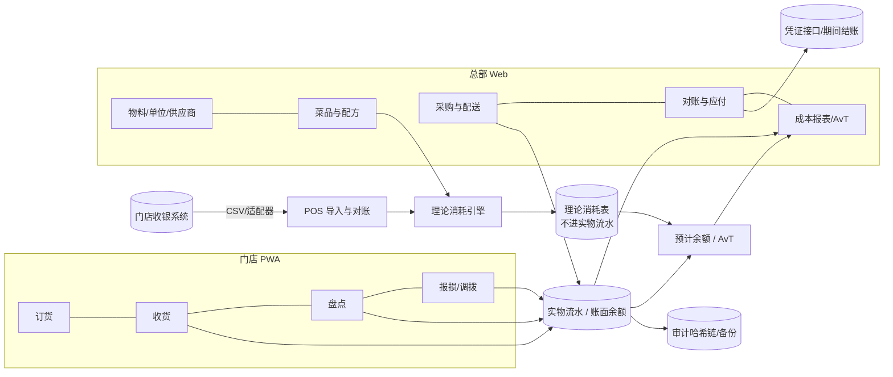

# 连锁餐饮门店轻量 ERP：产品与技术详细方案 v1.4（设计基线）

日期：2026-11-01（Asia/Shanghai）。v1.1 吸收了 Codex（gpt-6-astra，medium）首轮审计的 13 条发现；v1.2 吸收了对 v1.1 的复审（8 条部分闭合 + 11 条新发现 B1–B11）；v1.3 吸收了第三轮审计（9 项部分闭合 + 7 条新发现 C1–C7）；v1.4 吸收了第四轮审计（9 项部分闭合 + 7 条新发现 D1–D7），把迟到事件从“就地补偿”改为“未结期间重放、已结期间增量更正”。处置见 [03-codex-audit.md](03-codex-audit.md)。基线：`origin/main` `bea2d2d46775618ec128a500c329024047f9d5f9`（迁移止于 075，ADR 止于 0057）。
状态：**设计基线 v1.4**（2026-11-01 冻结，见 §0）。问题重构与专家方法见 [01-expert-framing.md](01-expert-framing.md)。
不授予合并、发布、部署、真实数据访问或付费外部服务权限；不宣称商业就绪。设计基线 ≠ 实现完成 ≠ 验收通过。

---

## 0. 基线说明

### 0.1 为什么在第四轮后停止整篇文档审计

| 轮次 | 审阅版本 | 新发现 | 发现所在层次 | 未闭合 |
|---|---|---|---|---|
| 1 | v1 | 13 | 产品范围、领域口径、计划、合规、现状描述 | — |
| 2 | v1.1 | 11 | 记账模型、精度、并发、授权时序 | 0 |
| 3 | v1.2 | 7 | 迟到事件、成本写入边界、量化 | 0 |
| 4 | v1.3 | 7 | 迟到事件的批次/成本/跨店细节、全文同步 | 0 |

- 产品范围、角色旅程、架构、数据范围与授权边界在第 2 轮后不再出现新问题；四轮均未发现越权内容。
- 第 3、4 轮的阻断项全部集中在**一个子系统**（迟到事件与成本台账，ADR-0059 / RC-02），且都是可以写成数值样例的会计边界情形。这类问题用**可执行的黄金样例和代码审计**验证，比继续审文字更可靠：文字审计只能推演，测试能证明。
- 因此停止整篇文档审计，改为下方 §0.3 的定向验证。

### 0.2 冻结范围

冻结：§1 范围、§2 旅程、§3 架构、§4 领域规则（含 §4.5 三数量模型、时间模型、迟到事件规则 1–4，§4.1 数值尺度与唯一写入边界，§4.9 勾稽等式与加工转换）、§5 数据模型方向、§7 验证策略、§8 门禁与退出条件、§10 待决策清单。

不冻结（在 ADR 阶段细化，不需要回改本基线）：字段/索引/表名、旧入口兼容矩阵的逐函数清单、盘点锁释放与复核流程、归档水位与重导入幂等、可接受的量化误差值、重放的性能方案。

### 0.3 冻结的附带条件（未满足前不得据本基线宣称对应规则已验证）

1. **v1.4 迟到事件规则未经独立审计**（它替换了 v1.3 的就地补偿）。在 RC-02 中先写黄金样例测试，覆盖四轮审计的全部反例：两笔迟到收货（余额 170）、盘盈批次已消耗、盘后出库 60（90 单位 / 120 元）、已结期间增量（170）、迟到报损、调拨两端、负批次进入复核；测试与 ADR-0059 一起送一次**定向**独立审计（只审 ADR-0059 与测试代码）。
2. RC-01（ADR-0058 数值尺度）可直接开工。
3. 需外部确认、不由开发方自证的事项：§10 的 D1–D8；进货查验记录留存期限的现行条文（用户/法务）；加工损耗资本化与食材成本率口径（财务）。
4. 真实数据仍受 §8 门禁 G0 约束；部署仍需单独授权。

### 0.4 变更控制

基线之后，对冻结范围的修改须通过 ADR 提出并说明理由，升版本号（v1.5…）并在 [03-codex-audit.md](03-codex-audit.md) 或 ADR 中记录；涉及 §4.5、§4.1、§4.9 的修改需再次独立审计。ADR 阶段的细化不升基线版本。

---

## 1. 产品定位与范围

### 1.1 目标客户与形态

- 5–50 家门店的中式连锁餐饮，直营为主，可含少量加盟；可有中央厨房/总仓。
- 每家企业一个独立实例（沿用现有“单企业独立实例”首版目标）；门店已有收银系统。
- 用户与终端：总部 PC（采购、财务、运营），门店手机/平板（店长、厨师长、收货员），区域督导手机。

### 1.2 做与不做

| 首版做（P0） | 二期（P1） | 不做 |
|---|---|---|
| 物料主数据与多单位换算 | 中央厨房生产（半成品工单、批次追溯） | 收银/点单/支付 |
| 菜品、配方（嵌套半成品）、出成率、版本；门店最小加工转换单（原料→半成品） | 预测订货（同期、星期、节假日、天气）；半成品批次谱系 | 会员营销、外卖平台运营 |
| POS 销售导入（CSV + 适配器接口）、日报对账 | 加盟店结算与价格体系 | 人事、排班、薪酬 |
| 理论消耗 | 电子发票数据对接（只存号码与附件之外的结构化数据） | 总账替代（只出凭证接口） |
| 订货指南、安全库存、配送日历/截单 | 供应商门户 | 多企业 SaaS 租户 |
| 要货 → 审核 → 配送/直送 | 温度传感器接入 | |
| 收货验收（差异、拒收、温度、照片、证照） | | |
| 批次效期、FEFO 提示、效期标签打印 | | |
| 报损（原因码）、店间调拨 | | |
| 分级盘点（A/B/C）、盘点模板、移动端、弱网 | | |
| AvT 差异、食材成本率、价格变动告警 | | |
| 供应商对账三单匹配、应付 | | |
| 月末全盘、成本结转、期间锁定 | | |
| 新店开店模板、异常工作台 | | |

---

## 2. 角色与核心旅程

| 角色 | 每日/每周任务 | 设备 |
|---|---|---|
| 店长 | 看异常工作台、审批订货、看昨日 AvT、处理差异 | 手机 |
| 厨师长 | 订货（按订货指南）、报损、A 类日盘、维护本店配方偏差申请 | 平板 |
| 收货员 | 对单收货、称重、拍照、记录温度、拒收 | 手机 |
| 区域督导 | 盲盘抽查、巡店异常、跨店对比 | 手机 |
| 总部采购 | 供应商与价格、审核要货、生成采购单、配送日历 | PC |
| 中央厨房/总仓 | 拣货发货、半成品生产（P1） | PC/平板 |
| 财务 | POS 对账、供应商对账、应付、月结 | PC |
| 研发/出品经理 | 菜品与配方、出成率、配方版本发布 | PC |
| 老板 | 食材成本率、门店排名、价格趋势 | 手机/PC |

关键旅程（每条都要有端到端测试与试点计时）：

1. **J1 订货**：厨师长打开订货指南 → 系统给出建议量（安全库存 + 预计消耗到下次到货 − 预计余额 − 入向可用在途，§4.6）→ 修改 → 截单前提交 → 店长审批（超额阈值）→ 总部汇总 → 供应商/中央厨房。
2. **J2 收货**：按送货单逐行确认数量/重量 → 差异与拒收原因 → 温度（冷链）→ 拍照 → 证照（首次供应或批次证明）→ 生成入库流水与批次 → 差异回传采购/应付。
3. **J3 日盘**：按库位顺序的 A 类模板 → 整箱+散装录入 → 离线可用 → 提交 → 差异 > 阈值要求复盘或备注。
4. **J4 报损/调拨**：选择物料与原因码 → 拍照（可配置必拍）→ 入流水。
5. **J5 每日成本**：POS 数据导入 → 与 POS 日报多维对账（不等即阻断）→ 理论消耗 → T+1 08:00 前出日报：A 类按实盘计算 AvT，B/C 类标注“估算”并显示盘点覆盖率与最近盘点时间；完整 AvT 以两次有效盘点为周期（§4.9）。
6. **J6 供应商对账**：月度/半月对账单导入 → 订单/收货/发票三单匹配 → 差异逐笔处理 → 应付确认 → 付款（复用资金复核）。
7. **J7 月结**：月末全盘 → 成本结转 → 期间锁定（复用期间结账与审计）。
8. **J8 开新店**：选模板门店 → 复制物料集、配方适用、订货指南、库位、盘点模板、角色 → 录期初。

---

## 3. 总体架构

### 3.1 原则

- **单体模块化**：沿用现有 Node 22 + Express + better-sqlite3 + React/Vite 单体，新增 `restaurant` 领域模块，不引入微服务或新运行时。
- **实物事件流水为真、余额为投影**：只有实物事件（收货、退供、调拨、报损、加工转换、盘点调整）写 `inventory_transactions` 并可重建**账面余额**；理论消耗写独立的 `theoretical_consumption` 表，不进入实物流水，只用于**预计余额**与 AvT（三种数量的定义见 §4.5）。
- **POS 不可信直到对账通过**：导入批次有状态机，只有 `reconciled` 批次参与成本计算。
- **门店端 PWA**：同一前端代码，门店路由为移动布局；离线队列只覆盖收货、盘点、报损三类“可安全排队”的写操作。
- **复用平台能力**：认证/会话、数据范围（org scope）、审计哈希链、能力门禁、迁移校验、备份加密与恢复演练、期间结账、资金复核、结构化日志。

### 3.2 模块图

### 3.3 部署

- 每企业一台 Linux 主机（云主机或总部机房），容器镜像沿用 ADR-0012；HTTPS 反向代理；门店通过公网访问。
- SQLite WAL 单写者。负载估算：50 店 × 每日约 1,500 POS 订单行 ≈ 7.5 万行/日，集中在闭店后导入；门店写操作为低频人工录入。该量级预计在单写者模型内，但**必须**按餐饮负载形态（闭店集中导入 + 早间订货高峰 + 月末全盘）补测：造数沿用 main 上的 `scripts/synth-data.mjs` / `scripts/synth-pipeline.mjs`；混合负载框架 `scripts/mixed-soak.mjs` 目前只在未合并的 PR32（`codex/mixed-soak`，`7c9349b`）中，需待其合入后再扩展。取得精确 SHA 的托管证据后才可引用。
- 切换 PostgreSQL 的触发条件（写入排队 p95 > 1 s、门店 > 100、多实例需求）记录为 ADR，不预先迁移。

---

## 4. 关键领域设计

### 4.1 数值精度（ADR-0058，P0 前置）

区分三种尺度，不能一律“到分”：

| 用途 | 表示 | 说明 |
|---|---|---|
| 结算金额（单据合计、应付、凭证） | 整数**分**（`*_fen INTEGER`） | 只在单据结算时点舍入一次，尾差归集到最后一行 |
| 单价、移动平均成本、配方成本、中间计算 | 整数**微元**（1e-6 元，`*_micro INTEGER`） | 20 元/kg = 20,000 微元/g；避免按克成本被截断 |
| 数量（实物流水、库存、盘点） | 整数**千分位**（`*_milli INTEGER`），以物料库存单位计 | 例：库存单位 g 时 1 g = 1000 |
| 理论消耗 | 整数**百万分位**（`qty_micro INTEGER`），以物料库存单位计，**按销售行**存储 | 任意时间区间（营业日、盘点截点前后）的理论消耗 = 区间内销售行的精确整数和，拆分不产生舍入差；与千分位比较时千分位 × 1000（转换与累计同样受下文界限检查）；单条记录舍入误差 ≤ 0.5 百万分位，N 条之和的最坏累计误差 ≤ N × 0.5 × 10⁻⁶ 库存单位——“可加守恒”不等于无限精度，可接受误差在 ADR 冻结 |
| 单位换算系数 | **有理数**（`factor_num`/`factor_den` 两个整数） | 可精确表达 1 箱 = 12 袋 × 500 g，及任意大跨度换算 |

- 统一 `server/lib/fixed.js`：解析、乘除（BigInt 中间值）、量纲检查、`Number.MAX_SAFE_INTEGER` 溢出检查、按单据结算舍入；禁止在新代码里对金额/成本使用浮点运算（加守卫脚本扫描新模块）。
- **餐饮成本的权威存储是新表**：`item_cost_ledger(store_id, item_id, qty_milli, value_micro, …)`，移动平均成本由“结存金额 ÷ 结存数量”派生，不单独存。现有 `server/lib/stock.js` 把单位成本保留 4 位小数，会把 49 微元/g 截成 0，因此旧 `REAL` 成本列对餐饮物料只作**兼容投影**（供旧页面展示，标注“近似”）；餐饮成本报表、AvT、月结**只读新表**，并有守卫测试禁止餐饮报表读取旧成本列。
- **唯一写入边界**（只读约束不够，必须同时约束写）：
  - 新增 `server/lib/restaurant-posting.js` 作为餐饮物料（`item_type` 为 `ingredient`/`semi`/`packaging`）**唯一**的实物过账入口。一次过账在单个事务内同时写：实物流水 `inventory_transactions`、数量 `inventory_stocks`、权威成本 `item_cost_ledger`、旧成本兼容投影（`inventory_stocks.cost_price`、`stock_cost_ledger`）以及相关应付/差异记录；所有写入共享同一事件幂等键。
  - 现有 `stock.js` 入口（采购收货、配送收货、调拨、盘点、POS 等调用方）遇到餐饮物料时**拒绝**，除非调用来自 `restaurant-posting`（显式上下文标记）；配送收货（`server/routes/requisitions.js` 收货段，目前直接调用 `stock.js` 并使用旧单价）改为对餐饮物料调用新入口。加负向测试：每个旧入口对餐饮物料返回明确错误。
  - 期初切换：期初库存与成本从同一份导入同时生成 `item_cost_ledger` 与旧投影。
  - 一致性检查：每日比较 `inventory_stocks` 与 `item_cost_ledger` 的数量（按门店/物料），不一致即告警，并阻断该门店月结；提供从实物流水重建 `item_cost_ledger` 的工具。
  - 在 ADR 中列出旧列清单与后续迁移计划。
  - **旧入口兼容矩阵**（基线 `bea2d2d` 中调用 `applyStockIn`/`applyStockOut` 的模块；ADR 逐个函数细化）：

    | 模块 | 对餐饮物料的处理 |
    |---|---|
    | `server/routes/requisitions.js`（配送收货、配送发货） | **适配**：改调 `restaurant-posting` |
    | `server/lib/purchase.js`、`server/lib/returns.js`（采购收货、退供） | **适配**：餐饮门店直送收货与退供走新入口 |
    | `server/lib/transfer.js`（调拨） | **适配**：按 §4.5 规则 3 的两端事件 |
    | `server/lib/pos2.js`、`server/routes/pos.js`（旧 POS 销售与旧盘点，含 `round2`） | **禁用**：餐饮物料不经旧 POS 出库（理论消耗不扣实物），盘点走新路径 |
    | `server/lib/mfg.js`、`server/routes/outsourcing.js`、`server/lib/qc2.js`、`server/lib/costing.js` | **禁用**：餐饮加工走加工转换单；成本以新台账为准 |
    | `server/routes/sales.js`、`server/routes/oms.js`、`server/routes/inventory.js` 中的手工出入库 | **禁用**（库存查询页面仅显示近似成本） |
    | `server/lib/settings.js` 及其他内部复用 | 只承担旧投影职责，**不得**把旧四位成本结果回灌新台账 |

    “来自 `restaurant-posting`”的上下文标记只能由服务端内部调用生成（不可由请求参数设置），并有测试；`stock.js` 自身会同时写数量、成本与流水，新入口复用它时必须避免重复写入，ADR 中选定“新入口直接写数量与投影”或“新入口调用 `stock.js` 只写数量与投影、自己写新台账”之一。
- **舍入与余数规则**：
  - 换算与配方展开在 BigInt 有理数中计算，**每条单据行只量化一次**到千分位（四舍六入五成双），单据内尾差归集到最后一行；
  - 理论消耗**每条销售行**在 BigInt 有理数中计算后量化一次到百万分位（四舍六入五成双）并存储；任何区间汇总都是这些整数的精确和，不再二次量化，保证“任意截点拆分后之和 = 原汇总”；
  - 出库成本 = 出库数量 × 结存金额 ÷ 结存数量，量化到微元；结存数量归零时剩余金额（正或负）一次性转入“成本尾差”调整，保证金额守恒；
  - 界限：单值 |金额| ≤ 9×10¹⁵ 微元（约 90 亿元）、|数量| ≤ 9×10¹⁵ 千分位或百万分位（含千分位 × 1000 后的值），输入或累计超过即拒绝并报错，不静默截断。
- 已知债务：现有盘点提交路径用 `round2` 计算差异（`server/lib/pos2.js` 盘点提交段），餐饮盘点不复用该路径，改用 `fixed.js`。

### 4.2 物料与多单位

- `items` 复用 `products`/`product_skus`，新增 `item_type` 取值 `ingredient`（原料）、`semi`（半成品）、`packaging`；成品菜品不进库存。
- `uoms`（g、kg、ml、L、个、袋、箱…，带量纲：质量/体积/计数）与 `item_uom_conversions(item_id, from_uom, to_uom, factor_num, factor_den, pack_version, effective_from)`；每物料指定**库存单位**、默认**采购单位**、**配方单位**。供应商改包装规格时新增 `pack_version`，历史单据保留当时的换算。
- 保质期新增 `shelf_life_hours`（优先于 `shelf_life_months`），开封后效期 `opened_shelf_life_hours`（标签打印用）。
- 储存区域 `storage_zone`（冷藏/冷冻/干货/常温），用于盘点模板与收货温度规则。
- 过敏原、营养字段预留（可空）。

### 4.3 菜品与配方

- `menu_items`：菜品（含套餐标记）；`menu_item_pos_map(store_id?, pos_source, external_item_id, external_modifier_id?)` 把 POS 编码映射到菜品或加料。
- `recipes` + `recipe_versions(effective_from, effective_to, status: draft/published/retired)` + `recipe_lines(item_id|semi_recipe_id, qty_milli, uom, yield_pct_milli, waste_pct_milli)`。
- 现有制造 BOM 已有 `version`、`effective_from/to`、`loss_rate` 字段并按生效期筛选（`server/db/migrations/023_bom_and_work.cjs`、`server/lib/bom.js`）；餐饮配方缺的是**发布后不可变的版本**、与销售时点的绑定和出成率语义，因此新建配方表而不是改造制造 BOM。
- 半成品可嵌套，发布时做**环检测**与**展开缓存**，展开结果带版本号，理论消耗引用展开缓存版本，保证可追溯。
- **展开止于库存物料**：若半成品是被库存管理的物料（中央厨房配送或门店加工后入库），配方行展开到该半成品即停止，理论消耗记在半成品上；只有“现做不入库”的半成品才继续展开到原料。这样门店 AvT 比较的对象与门店实际持有的库存一致。
- **门店最小加工转换单（P0）**：记录投入原料（数量、批次）、产出半成品（数量、新批次与效期）、加工损耗、所用配方版本；生成原料出库与半成品入库两条实物流水。原料的减少由此解释为“转换”，不会被误判为损耗。完整批次谱系放 P1。
- 配方版本生效区间为半开区间 `[effective_from, effective_to)`，以门店时区（默认 Asia/Shanghai）的时间戳计；同一配方的已发布版本区间不得重叠（发布时校验）。销售行按**下单时间戳**解析版本，而不是按营业日，保证切换当日的结果唯一。
- 门店差异：`recipe_store_overrides`（经审批），用于地方化份量；默认全连锁统一。
- 套餐：展开为组成菜品；加料（加份/加辣）映射为附加配方行；“去葱”类负向加料默认忽略，可配置。
- 配方成本 = Σ（行用量 ÷ 出成率 × 物料当前移动平均成本），按日快照，供菜品毛利分析。

### 4.4 POS 导入与对账

- 适配器接口 `PosAdapter { fetchDay(storeId, bizDate) → {orders, lines, dailyTotals} }`；首版实现 **CSV 模板导入**（含字段校验与错误行报告），具体收银厂商 API 适配器待用户确认厂商与授权后再做，**不调用任何真实付费外部服务**。
- 幂等键：`(pos_source, store_id, external_order_id, external_line_no)`；重复导入覆盖同版本，修订（退菜/改单）生成新版本并留差异。
- 批次状态机：`uploaded → validated → reconciled | mismatch → (corrected) → reconciled → consumed`。
- 对账维度（金额一致不足以证明食材数据完整）：订单数、行数、菜品数量合计、零价行（赠菜）数、退款/退菜行数与金额、套餐子项展开数、金额（含/不含折扣分别），全部与 POS 日报或导出汇总一致；并要求**完成标记**（POS 侧日结完成或导出文件声明的截止时间）。
- **映射覆盖率必须 100%** 才能进入 `consumed`；存在未映射菜品时整批阻断，不得部分消耗。
- 人工放行只允许“金额类”差异（如渠道手续费口径），需复核人（复用 maker-checker）并写明原因；放行后该营业日的成本报表标记为**不完整**。数量/行数/映射类差异不可放行。
- 营业日：切点带历史版本 `store_biz_day_cutoffs(store_id, cutoff_time, effective_from)`（默认 04:00），订单按 POS 时间戳和**当时生效**的切点映射营业日；切点变更只对生效日之后的订单起作用，不重划历史营业日。
- 未映射的 POS 菜品进入“待映射”队列，不静默丢弃；映射后可重算。

### 4.5 理论消耗引擎

- 输入：已对账批次的销售行 × 按下单时间解析的配方展开版本；输出：`theoretical_consumption(store_id, biz_date, order_at, item_id, qty_micro, recipe_version_id, source_batch_id, source_line_id, kind)`。保留 `order_at` 是为了按盘点截点精确划分“盘点前/后”的理论消耗。

**唯一记账模型（ADR-0059）**——每个物料有三种数量，用途固定：

| 数量 | 定义 | 用途 |
|---|---|---|
| 账面余额 | 实物事件流水累计：收货、退供、调入/出、报损（W）、非销售耗用（M，§4.9）、加工转换投入/产出、盘点调整 | 财务结存、月结、盘点调整基数 |
| 预计余额 | 账面余额 − `order_at` 晚于该物料**最近一次有效盘点截点**的理论消耗（T） | 订货建议、临期/缺货预警、异常工作台 |
| 实盘数量 | 盘点录入值 | 盘点调整、AvT |

- 每笔耗用只能进入 T、W、M 之一：POS 中出现的（含赠菜、退菜损耗、重做）属 T；报损单属 W；未在 POS 录入的员工餐/试菜/外部赠送以“非销售耗用单”登记，属 M。W 与 M 都是实物出库流水，T 不是。
- 盘点提交时：调整流水 = 实盘 − 截点账面余额（使账面回到实物）。盘点报表另行展示**库存偏差 D = 实盘 − 截点预计余额**。
- **D 与 X 的关系**：设两次盘点实盘 P₀、P₁，期间净流入（收货 − 退供 + 调入 − 调出 + 加工产出 − 加工投入）F，周期内记入账面但不属于本周期耗用的其他调整 A（如前期调整、期间更正），则账面 B = P₀ + F − W − M + A，D = P₁ − (B − T) = **−X − A**。因此只有当 A = 0（未结期间的迟到事件已通过重放归入正确周期，已结期间的更正单列为前期调整）且 D、X 使用同一截点、同一事件版本时，才有 **D = −X**。报表同时显示 D、X、A；A ≠ 0 时提示“本周期含其他周期调整”。数量与金额两套等式分别验收。
- 预计余额允许为负（说明理论消耗超过账面，常见原因：漏收货、配方偏大），只告警，**不触发**现有实物出库的库存不足门禁（`server/lib/stock.js` 出库校验段）。
- 连续样例（周盘物料，含报损与员工餐）：周一 10:00 盘点 100 → 账面 100、预计 100；周二至周四理论消耗 40 → 账面 100、预计 60；周三报损 3、员工餐 2（M）→ 账面 95、预计 55；订货按 55 计算；周五收货 50 → 账面 145、预计 105；周日 10:00 盘点实盘 100 → 调整流水 100 − 145 = −45，账面 100；D = 100 − 105 = −5。§4.9 口径：U = 100 + 50 − 100 = 50，T = 40，W = 3，M = 2，X = 50 − 40 − 3 − 2 = 5 = −D。

**时间模型与迟到事件**：
- 每个实物事件有**发生时间** `effective_at`（业务实际发生，如送货签收时刻）和**入账序号** `posted_seq`（服务器写入顺序）。盘点截点 = 盘点单的观察时点 `observed_at`。
- 调整前基数 B*_C = 该（门店、物料、库位）所有 `effective_at ≤ C 截点` 的已入账事件之和，**排除盘点 C 自身的原调整及其全部更正**（更早盘点的调整保留）；同一 `effective_at` 按 `posted_seq` 排序。盘点 C 的有效调整 J*_C = P_C − B*_C。

**迟到事件**：入账时，其 `effective_at` 早于同一（门店、物料、库位）某张已过账盘点的截点。v1.3 的“就地补偿 + 按原批次反向”在盘盈批次已被消耗、盘后已有出库、跨门店调拨时无法同时保证批次与成本正确（第四轮审计 D2–D4），v1.4 改为下列标准做法（ADR-0059 细化字段、索引与性能，规则在此冻结）：

1. **未结成本期间内：按事件时间重放重算。** 迟到事件按其 `effective_at` 插入该（门店、物料）的事件序列；系统从该时点起、到当前为止，在单个事务内**重放**该物料在本未结期间的事件：
   - 每张受影响盘点的调整按 J*_C 重新计算（不自引用，见上文 B*_C 定义）；
   - 移动平均成本、出库成本、系统按 FEFO 分配的批次全部重算；用户明确指定批次的出库保持其批次；
   - 结果与“该事件按时入账”的历史完全一致（数量、价值、批次三者），因此后续盘点、出库成本、AvT 一并更正，不再需要单独的补偿分录。
   - 重放前后差异写入“重述”审计记录（关联迟到事件、受影响盘点与出库、前后数量/价值），报表对受影响周期标注“已重述”。
   - 若重放会使用户指定的某批次为负，或改变已被下游单据（调拨、加工）引用且下游已过账的批次分配，则整笔迟到事件进入**复核队列**，不过账、不制造负批次；复核人选择“改为在当前时点入账”或“撤回下游单据后重放”。
   - 例（第四轮的成本反例）：100 单位/100 元；09:00 收货 50/100 元未联网；10:00 盘点 150；之后出库 60；补录收货后重放 → 盘点调整 0，出库 60 按均价 200/150 计 80 元，余 90 单位/120 元，与按时入账一致。
2. **期间已结账：只记增量更正，不重放已结期间。** 计算受影响盘点 C 的 J*_C 与其“原调整 + 既往更正”合计之差 ΔJ（**本次增量**），在当前未结期间过账：迟到事件本身（数量、真实成本、批次、应付按实）+ 数量为 ΔJ 的更正，二者都标记“前期调整”，在 AvT 中单列，不计入当期 T/W/M/X；价值差额进入“前期成本调整”行；需审批（复用 maker-checker），并关联历史盘点与累计更正。例：已结期间原调整 +70，补录收货 50 → ΔJ = −50，余额仍为 170，未解释盘盈 20 保留。批次不足时同样进入复核队列。
3. **调拨按两端独立处理**：发出（A 店）、在途、收货（B 店）是关联但身份独立的事件，各有自己的 `effective_at`、幂等键和所属期间。A 店迟到发出只在 A 店时间线上按规则 1/2 处理；B 店是否已收货、是否已被 B 店盘点吸收，由 B 店收货事件在 B 店时间线上独立处理——B 店尚未确认收货时只形成在途，不直接补收货。两端不复用对方的受影响盘点。
4. 重放范围限于单一（门店、物料）的一个未结成本期间，规模有上界；性能（索引、批量重放）在 ADR 与容量测试中验收。
- 备选方案“实时扣减 + 盘点调整”在 ADR 中记录拒绝理由：POS 数据次日才对账，实时扣减会让账面在对账前后来回变化，并与 FEFO 批次扣减冲突。

**退菜与修订规则**（收入事件与厨房耗用事件分开）：

| 情形 | 收入 | 理论耗用 |
|---|---|---|
| 未制作即取消 | 冲减 | 不产生 |
| 已制作后退款/退菜 | 冲减 | 保留，类别记为“退菜损耗” |
| 重做 | 不变 | 增加一份，类别“重做”（POS 有重做记录则导入，否则在报损登记） |
| 跨营业日退款 | 记入退款营业日 | 保留在原销售营业日 |

- 导入需保留原销售行与退款行的关联（POS 外部 ID）和厨房处置标记；POS 不提供处置标记时，默认按“已制作”处理并在报表注明口径。
- 重算：配方映射修正或批次重新对账后，仅对**未结期间**按营业日重算并记录前后差异；已结期间不覆盖历史结果，差额以审批过的“后期调整”记入当前未结期间。后期调整在 AvT 报表中单列为“前期调整”行，不计入当期 T/W/M/X，也不改变预计余额（它对应的理论消耗发生在已过账盘点之前，已被该次盘点吸收）。

### 4.6 订货

- `order_guides(store_id, item_id, par_qty, order_uom, min_order, supplier_id, sort)`；`supplier_delivery_calendars(supplier_id, store_id?, weekday, cutoff_time, lead_days)`。
- 建议量 = max(0, 安全库存 + 预计消耗(到下次到货) − 预计余额 − 入向可用在途)，其中**入向可用在途** = 已发往本店、尚未收货、未被拒收，**且预计到货时间不晚于下次到货机会**的数量（与“预计消耗到下次到货”使用同一时间窗口）；预计到货时间未知或已逾期的在途不扣减，进入异常工作台；拒收后待退回或退回途中的数量记在单独的“退回责任台账”，**立即**退出订货可用量，但继续保留到退回签收或确认运输损耗为止。向上取整到订货单位/最小起订量。预计消耗首版用最近 4 个同星期的理论消耗均值；P1 再加节假日/天气。
- 复用 `store_requisitions` 作为要货单；直送供应商的门店订单汇总生成 `purchase_orders`；中央厨房供货走 `store_shipments`。
- 复用配送收货前必须改造（现有 `server/routes/requisitions.js` 收货段：已收行直接跳过、未传明细时自动按发货数全收、按服务器自然日入库、短收直接记差异并结束）：
  1. 支持同一行**分次收货**与逐批验收；
  2. 新验收流程**禁止**无明细自动全收，必须逐行确认数量与（冷链）温度；
  3. 拒收数量进入“待退回/退回在途”状态，退回签收或确认运输损耗后才从在途量释放；
  4. 入库日期按门店**营业日**而非服务器自然日；
  5. 差异分类（短少/拒收/运输损耗）分别回传配送方与应付。
- 截单后锁定，超时需店长 + 总部审批。

### 4.7 收货验收

- 收货单来源于采购单/配送单；逐行录入实收数量/重量（支持整箱+散装）；差异原因（短少/超量/质量/温度/效期不足）；拒收行不入库。
- 冷链物料必须录入温度，超出 `storage_zone` 阈值时默认拒收（可由店长覆盖并留审计）。
- 照片与证照：现有仓库**没有**通用附件模块，需新增：文件落在实例数据目录（受 `check-data-paths` 约束），限制类型与大小，记录 SHA-256，并纳入备份；首次供应物料或批次要求证照。
- 入库生成批次（供应商批号或系统批号）+ 效期，FEFO 排序提示与标签打印（浏览器打印 58/80mm 模板）。
- 进货查验记录保留：按食品安全法对进货查验记录的要求（保质期满后至少 6 个月，无明确保质期的至少 2 年；上线前由用户/法务确认现行条文与适用范围）。起算依据为该批次的到期日；无到期日按收货日起算 2 年。
- 现有 retention（`scripts/retention.mjs`）只清理审计、通知、MCP 日志，现有备份（`scripts/db-backup.mjs`）只覆盖 SQLite 及审计旁车文件。因此需要：
  1. 备份集扩展为“数据库 + 附件目录 + 附件哈希清单”的一致性快照；
  2. 恢复演练增加**引用完整性检查**（每条查验记录的附件存在且哈希匹配）；
  3. 删除保护：保留期内的查验记录与附件不可被任何清理任务或界面删除（负向测试）；
  4. 验收项：“从备份恢复后，可调取指定批次的完整查验材料”，而不只是数据库恢复成功。
  5. **附件存储只追加**：按内容哈希寻址，引用中或在留存期内的附件不被任何轮转删除；附件存储独立做增量备份，不随数据库快照轮转。
  6. **查验记录独立归档**：每日把当日查验记录导出为带哈希清单的只读归档（JSON + 附件引用），按留存期保留，与数据库备份分开轮转。恢复到较旧快照后，快照之后、仍在留存期内的查验记录可从归档调取，并经对账工具重新导入；验收覆盖“恢复目标之后的记录仍可调取”。
  7. **备份集保留规则**：数据库备份轮转不得早于其所含查验记录的最长留存期删除最后一份覆盖该记录的备份——或由第 6 条的独立归档承担此义务；二者择一写入 ADR，并有对应测试。现有轮转（`scripts/db-backup.mjs` 清理段）只识别数据库与审计旁车文件，需要扩展。

### 4.8 盘点

- `count_templates(store_id, class: A|B|C, frequency, zone 顺序)`，物料 ABC 分级由最近 90 天成本占比计算并允许人工调整。
- 盘点单有**观察时点**：每行记录 `observed_at`（设备录入时间，经服务器时间差校正），作为该物料的盘点截点；截点账面（调整前基数 B*_C）、预计余额与迟到事件重放按 §4.5 时间模型计算。可选“冻结窗口”（盘点期间禁止该区域收货/调拨）。
- **跨盘点单的并发控制**：同一（门店、物料、库位）同一时间只允许一张**未过账**盘点单包含它（建单时校验，交叠拒绝）。过账在单个写事务中完成（SQLite `BEGIN IMMEDIATE` 串行化），过账前检查“该物料不存在截点 ≥ 本单截点的已过账盘点”；若存在，本单该行只作为历史观察记录保存，不生成调整，也**不作为** AvT 周期端点。锁的释放（取消、超时）与冲突复核流程在 ADR 中细化。这样两张单据基于同一账面各扣一次的情况不会发生。
- 支持多人分区并行、整箱+散装、未盘到的行明确标记“未盘”而非 0。
- 差异超阈值（数量或金额）要求复盘或备注；盲盘模式（不显示系统数）用于督导抽查。
- 提交后生成盘点调整流水；月末全盘为期间结账前置条件。

### 4.9 AvT 与成本报表

**周期**：完整 AvT 以该物料**两次有效盘点之间**为周期。A 类日盘即每日周期；B/C 类在日报中只显示理论消耗与预计余额，标“估算”，并显示盘点覆盖率与最近盘点时间。不得用理论消耗反推期末再称为实际 AvT。

**勾稽等式**（同一盘点周期、同一物料，数量与金额两套）：

- 总实耗 U = 期初实盘 + 收货 − 退供 + 调入 − 调出 + 加工转换产出 − 加工转换投入 − 期末实盘（**不减报损**；加工转换按内部转移处理，见下）
- 销售理论耗用 T = Σ 已对账销售 × 配方展开（含零价赠菜、退菜损耗、重做，见 §4.5；这些已在 POS 中出现，不再重复登记）
- 登记报损 W = 报损单合计（过期、操作失误、质量等原因码）
- 非销售耗用 M = 员工餐/试菜/外部赠送中**未在 POS 录入**的部分，以“非销售耗用单”登记，是实物出库流水（§4.5）
- 未解释差异 X = U − T − W − M；与盘点库存偏差的一般关系 D = −X − A，A = 0 时 D = −X（§4.5）

样例：期初 100、期末 20、无收货、报损 10、理论 70、M = 0 → U = 80，X = 80 − 70 − 10 = 0；若未登记报损，X = 10，即“未解释损耗”。

**加工转换的数量与金额守恒**（门店加工转换单，§4.3）：
- 投入数量**包含**加工损耗：投入原料 10 kg → 产出半成品 8 kg，加工损耗 2 kg 已体现在“投入 10、产出 8”之中，**不再**登记为 W。
- 金额：投入原料的全部成本资本化到产出，半成品单位成本 = 投入总成本 ÷ 产出数量；尾差计入最后一笔产出，保证投入金额 = 产出金额。例：10 kg × 20 元/kg = 200 元 → 8 kg 半成品，25 元/kg，合计 200 元。门店总食材成本因此不受转换影响，损耗成本在半成品被销售或盘亏时体现。
- **加工失败**（产出为 0，或厨师长将转换单标记为“失败”）：上述“资本化、不登记 W”的规则不适用；整张转换单转为报损单，原因码“加工失败”，投入数量与成本全部计入 W，半成品不入库。“不登记 W”只适用于产出 > 0 的成功转换，因此不会重复计入。
- 正常损耗与超损：配方给出标准出成率区间（如 80%–85%）。仅当实际出成率低于下限时计算**加工超损** P = 投入 − 产出 ÷ 标准出成率下限（按投入成本计价），否则 P = 0；在加工报表和 AvT 中单列展示，用于管理；P 不改变 U/T/W/M/X 的勾稽（它已包含在半成品成本中）。例：标准下限 85%，产出 8 kg 应投入 9.41 kg，P ≈ 0.59 kg 原料 ≈ 11.76 元。
- 按物料计算 U 时，原料的“加工转换投入”和半成品的“加工转换产出”各自记入对应物料；全店汇总时二者金额抵消。

- 按物料、类别、门店、周期展示 T/W/M/X 构成；X 超阈值进异常工作台。
- 食材成本率 = U 金额 ÷ 净销售额（U 包含报损，体现总成本；折扣、服务费、员工餐口径在 ADR 定义并由财务书面确认）。
- 价格变动告警：收货单价相对上次/合同价超阈值；配方成本日快照变化超阈值。

### 4.10 应付与对账

- 复用采购结算、付款释放台账（ADR-0024）、资金复核（ADR-0018）。
- 新增供应商对账单导入与三单匹配：采购单价 × 实收数量 vs 发票/对账单；差异类型（价差/量差/未收货开票/已收货未开票）逐笔处理。
- 月结生成成本结转凭证（通过现有凭证模块的接口输出，不替代总账）。

### 4.11 弱网与离线

- 仅收货、盘点、报损三类写操作允许离线排队；每条带客户端 UUID（幂等键，只解决重试）、设备 ID、操作人、观察时间与服务器时间差。
- **冲突协议**：每个可编辑行带服务端 `row_version`；客户端提交携带其读取时的版本，服务端条件更新（版本不符即冲突）。冲突不自动覆盖，进入“待复核”，由店长/盘点负责人选择或要求复盘；晚联网的旧结果不能覆盖较新的结果。
- 重放时服务端重新校验：操作人当前权限与会话是否有效、期间是否已锁定、单据状态是否允许；任一不满足即拒绝并提示补录流程。
- 订货和审批必须在线（截单时间语义要求）。
- 纸质应急：可打印空白收货/盘点单，事后补录时标记 `paper_backfill` 与原纸单照片。

### 4.12 权限与数据范围

- 复用 org scope 机制（ADR-0026/0027）但**不直接套用其谓词**：ADR-0026 的销售单规则是“出货仓或门店任一在范围内即可见”，并非本店独占。餐饮模块为每类对象（要货、收货、盘点、报损、加工、POS 批次、成本报表、附件）单独定义范围谓词，覆盖列表、详情、统计、导出和附件下载五个出口，并加越店访问负向测试。目标：门店账号只见本店；督导见所辖区域；加盟店价格与结算数据和直营隔离。
- 附件下载/预览必须经所属单据鉴权，不依赖不可猜的文件名或哈希。
- 新增权限点：`recipe.publish`、`count.blind`、`receiving.override_temp`、`pos.reconcile.release` 等，迁移内声明并由 `check-route-authz` 守卫覆盖；角色矩阵 `gen-role-matrix --check` 更新。
- 门店共享平板：PIN 切换生成**服务端可验证的操作人上下文**（短时、可撤销，绑定设备会话），每个请求按**实际操作人**的权限授权，而不是继承设备账号的权限；审计记录设备与操作人。具体方案单独 ADR，需安全复审。

### 4.13 MCP/AI 能力

- 首版餐饮模块**不新增**生产环境 MCP 写能力；`agent_access` 在 production 保持关闭（与 V05 现状一致）。是否在 production 开放只读查询仍待用户对 V05 范围的决定，本方案不视为已授权。

---

## 5. 数据模型增量（迁移 076 起，草案）

| 迁移 | 内容 |
|---|---|
| 076 | `uoms`、`item_uom_conversions`；`products` 增 `stock_uom`、`purchase_uom`、`recipe_uom`、`shelf_life_hours`、`opened_shelf_life_hours`、`storage_zone`、`abc_class` |
| 077 | `stores.biz_day_cutoff`；`count_templates`、`count_template_items` |
| 078 | `menu_items`、`menu_item_pos_map`、`recipes`、`recipe_versions`、`recipe_lines`、`recipe_expansions`、`recipe_store_overrides`、`prep_conversions`（门店加工转换单） |
| 079 | `pos_import_batches`、`pos_import_lines`、`pos_daily_totals`、`pos_unmapped_items` |
| 080 | `theoretical_consumption`、`waste_records`（原因码）、`waste_reason_codes` |
| 081 | `order_guides`、`supplier_delivery_calendars`、`supplier_items`（包装、合同价、起订量） |
| 082 | `receiving_inspections`（温度、照片哈希、证照、拒收原因）、新增 `attachments` |
| 083 | `supplier_statements`、`supplier_statement_lines`、`three_way_match_results` |
| 084 | 新权限点与角色授予 |

所有迁移遵守 ADR-0009 校验和；只增不改既有列语义；每个迁移带“空库 + 合成大库”双测试。

---

## 6. 前端与可用性

- 门店端：大按钮、单手操作、扫码（物料条码/批次标签）、数字键盘、整箱+散装双输入、离线状态条、提交回执。
- 首页“异常工作台”：今日待收货、待订货（距截单倒计时）、临期、AvT 超阈值、未盘点、待映射 POS 菜品。
- 可用性目标：新员工经 15 分钟培训可独立完成收货与日盘；SUS ≥ 70；A 类日盘 ≤ 30 分钟；订货 ≤ 10 分钟。
- 无障碍与弱光：高对比、字号可调（后厨环境）。

---

## 7. 测试与验证策略

| 类型 | 内容 |
|---|---|
| 单元/性质 | 定点运算、单位换算往返、配方展开（环检测、嵌套）、建议订货量、AvT 公式；库存守恒、金额守恒、导入幂等 |
| 黄金数据集 | 1 店 × 7 天 × 30 物料 × 20 菜品的手算样例，期望值由财务/厨师长签字（外部证据） |
| 负向 | 未对账批次不得参与成本；锁定期间拒写；越店访问拒绝；保留期内进货查验记录不可删；温度超限默认拒收 |
| 端到端 | J1–J8 旅程在浏览器场景（沿用现有 browser 测试、移动设备仿真） |
| 容量 | 合成 50 店 × 90 天 POS 行（约 675 万销售行），并**实际生成配方展开后的理论消耗记录**（每行平均展开 k 个物料，k = 10 时约 6,750 万条，另计修订版本）；测闭店导入、跨截点查询、配方修订重算与迟到事件重放；闭店集中导入 + 早间订货 + 月末全盘混合负载；造数用 `scripts/synth-data.mjs`/`synth-pipeline.mjs`，混合负载待 PR32 的 `mixed-soak` 合入后扩展；结论只适用于精确 SHA 与合成单写者 Linux 环境 |
| 恢复 | 复用恢复演练；新增“月结后恢复到月中”演练与“恢复后查验材料引用完整性”检查 |
| 冲突/离线 | 两台设备离线盘点同一行；两张盘点单交叠同一物料；旧观察结果在较新盘点过账后才到达；收货在盘点后迟到补录（重放）；重放时权限被撤销或期间已锁定 |
| 守恒 | A = 0 时 D = −X，A ≠ 0 时 D = −X − A；加工转换投入金额 = 产出金额，加工失败全部进 W；结存归零时成本尾差转出；拒收与逾期在途不计入订货可用在途；理论消耗任意截点拆分之和 = 原汇总 |
| 迟到事件 | 重放后数量、价值、批次与“按时入账”的历史一致（含盘盈批次已消耗、盘后已有出库）；多笔迟到收货；重放会造成负批次时进入复核而不过账；已结期间只记 ΔJ 增量（重复补录不过度冲销）；调拨两端独立处理且不重复入账 |
| 写入边界 | 每个旧 `stock.js` 入口对餐饮物料拒绝；`inventory_stocks` 与 `item_cost_ledger` 数量每日一致；从流水重建成本台账与当前一致 |
| 守卫 | `check-route-authz`、`check-data-paths`、`check-file-header`、`check-bizcode-shape`、`check-api-contract`、`check-audit-allowlist`、`gen-role-matrix --check`、`explain-audit --compare`、`gen-codemap --check` 等全部沿用；新增“新模块禁止浮点金额”扫描 |
| 环境 | GitHub-hosted Linux CI（当前阶段）；付费服务后 `dmserver`；本机 Node 检查不算目标平台验收 |

---

## 8. 试点与上线计划（12 周开发准备 + 等待月初 0–约 4.5 周（期间试运行）+ 一个完整自然月影子运行 + 月结，共约 18–22 周）

**依赖门禁**（未满足则对应阶段不得开始，不以“缺口经确认”代替）：
- G0（**首次接触任何真实素材之前**，即 R0 的素材收集之前）：用户书面的**数据授权**，覆盖读取、脱敏、分析、存储四个环节，以及数据范围、脱敏规则、存放主机。G0 未满足时，R0 只能准备素材清单模板、合成样例和访谈提纲，不得接触真实 POS、供应商、银行或员工数据。
- G1（R1 前）：在 G0 授权范围内取得至少 1 家试点门店 ≥ 4 周的 POS 订单行导出与日报样本；A 类物料的配方与实测出成率。
- G2（R4 前）：真实数据进入**系统**的授权（若 G0 未覆盖）；期初余额（库存、未结应付）冻结日。
- G3（R4 前）：**部署授权**单独确认（与数据授权分开检查；AGENTS.md 当前不授权部署）。

| 阶段 | 周 | 内容 | 退出条件（含外部证据） |
|---|---|---|---|
| R0 发现 | 1–2 | G0 满足后收集原始素材（01 §2.3）、跟班计时、访谈、ABC、出成率实测、基线 KPI；**冻结验收阈值** | G0、G1 满足；基线 KPI 表；阈值表经用户签字 |
| R1 地基 | 3–5 | ADR-0058/0059、单位、配方与加工转换、POS CSV 导入与多维对账、理论消耗 | 黄金数据集期望值经财务/厨师长签字并通过；精确 SHA 托管 CI 全绿 |
| R2 门店闭环 | 6–8 | 订货、收货验收（含配送收货改造）、报损、调拨、盘点、PWA 离线与冲突协议、异常工作台 | ≥ 5 名非开发人员可用性测试，SUS ≥ 70，任务完成率 ≥ 90%；端到端 J1–J5 |
| R3 财务闭环 | 9–10 | AvT 报表、价格告警、供应商对账、月结、新店模板、附件备份/恢复 | 用合成供应商对账单逐笔可解释；月结在合成数据上连续 2 个月可重复；恢复后查验材料可调取 |
| R3.5 缓冲与裁剪 | 11–12 | 修复与范围裁剪（裁剪顺序：新店模板 → 价格告警 → 离线，见下） | 试点就绪评审 |
| R4 影子运行 | 13 起 | 1 家试点门店 + 总部，与原流程并行；**从某自然月 1 日开始，到该月月结完成为止**（若第 13 周不在月初，第 13 周至下月 1 日之间做试运行，不计入验收） | 见下方阈值 |

**R4 退出阈值（R0 冻结的建议值，以用户签字版本为准）**：
- 影子运行月内每个营业日完成订货、收货与 A 类盘点（允许缺失 ≤ 1 天且有原因）；A 类盘点中位耗时 ≤ 30 分钟。
- POS 导入多维对账差额为 0 的营业日 ≥ 95%；其余每笔差额有原因、审批人，并在 3 个营业日内关闭，期末无未结差额。
- 督导盲盘（至少 2 次）：A 类物料 Σ|逐物料差异金额| ÷ Σ盘点金额 ≤ 2%（按绝对值，正负不抵消），且单个 A 类物料差异 ≤ 10%。
- 供应商对账：区分“正常未付应付”（允许存在）与“未解决的对账差异”；退出时**未解决对账差异必须为 0**，不接受以挂账说明代替。
- 该自然月完成月结（月末全盘 → 成本结转 → 期间锁定）；业务负责人书面签收（外部事项 A02）。

**裁剪机制**：若 R2 结束时进度落后 > 1 周，按“新店模板 → 价格告警 → 离线（改为在线 + 纸质应急）”顺序移出 P0，并记录于进度文档；配方、POS 对账、理论消耗、收货、盘点、AvT、对账不可裁剪。工期假设 2 名全职开发 + 1 名兼职业务分析，人员不足时按比例延长，而不是降低退出条件。

接触任何真实素材前必须满足 G0，真实数据进入系统前必须满足 G2；在此之前全部使用合成数据。

---

## 9. 与现有收尾工作的关系

- V05 混合长稳仍未通过；MCP 生产范围的二选一决定仍待用户回答。餐饮方案**不依赖**该决定，但 R1 之后的容量验证会新增餐饮负载形态，应在 V05 框架内统一，而不是另起一套。
- V02 慢启动（约 105 s，600 s 预算是缓解不是优化）在试点规模下影响重启恢复时间，列为 R1 并行的性能债务。
- A01–A04 外部事项（权属、业务试点签收、交付环境、运维交接）仍需有权负责人确认；本方案的 R4 正是 A02 的具体化。

---

## 10. 风险与待决策

| # | 风险/决策 | 建议 | 决策人 |
|---|---|---|---|
| D1 | 试点门店与收银厂商是哪家？能否拿到 3 个月订单行导出？ | 先用 CSV 模板，厂商 API 后做 | 用户 |
| D2 | 理论消耗是否实时扣减库存 | 不扣减账面；采用“账面/预计/实盘”三数量模型（§4.5，ADR-0059） | 用户 + 财务 |
| D7 | R4 退出阈值（§8 建议值） | R0 结束前签字冻结 | 用户 + 财务 |
| D8 | POS 是否提供退菜“已制作/未制作”标记 | 无标记时默认“已制作” | 用户（取决于收银厂商） |
| D3 | 食材成本率口径（折扣、服务费、员工餐） | 与财务书面确认 | 财务 |
| D4 | 真实数据授权、脱敏与存放主机 | 授权前只用合成数据 | 用户 |
| D5 | 门店共享设备的操作人识别 | PIN 切换 + 审计，需安全复审 | 用户 + 安全复审 |
| D6 | 加盟店是否进入首版 | 首版只做直营，加盟 P1 | 用户 |
| R1 | 期初数据质量差导致上线延期 | R0 即开始映射，设“期初冻结日” | — |
| R2 | 门店不坚持盘点 | ABC 分级 + 30 分钟上限 + 督导盲盘 | — |
| R3 | 浮点历史列与新定点模块混用 | 边界转换 + 守卫 + 旧列迁移计划 | — |
| R4 | SQLite 单写者在闭店集中导入时排队 | 导入分批事务、按店串行、容量补测 | — |

---

## 11. 第一批可执行工作包（建议，待用户确认后开 PR；RC-02 须满足 §0.3 第 1 条）

1. **RC-01** ADR-0058 数值尺度（分/微元/千分位/理论消耗百万分位/有理换算、误差与界限）+ `server/lib/fixed.js` + 守卫 + 测试。
2. **RC-02** ADR-0059 三数量记账模型、迟到事件重放与已结期间增量更正、调拨两端规则、`restaurant-posting` 唯一写入边界 + 勾稽等式与迟到事件的黄金样例（先写测试与文档，再写实现）。
3. **RC-03** 迁移 076/077：单位换算（有理系数、包装版本）、保质期小时、储存区、营业日切点 + 测试。
4. **RC-04** 迁移 078 + 配方服务：不可变版本、半开生效区间、展开止于库存物料、环检测、加工转换单、成本快照。
5. **RC-05** 迁移 079/080：POS CSV 导入、幂等、多维对账状态机、退菜规则、理论消耗 + 负向测试。
6. **RC-06** R0 素材清单模板、基线 KPI 表与验收阈值表（文档，供试点门店与用户填写签字）。

每个工作包使用独立 worktree 与 `codex/` 前缀分支，提交可审阅 PR，精确 SHA 的托管 CI 作为开发合并门禁；不自行合并。
